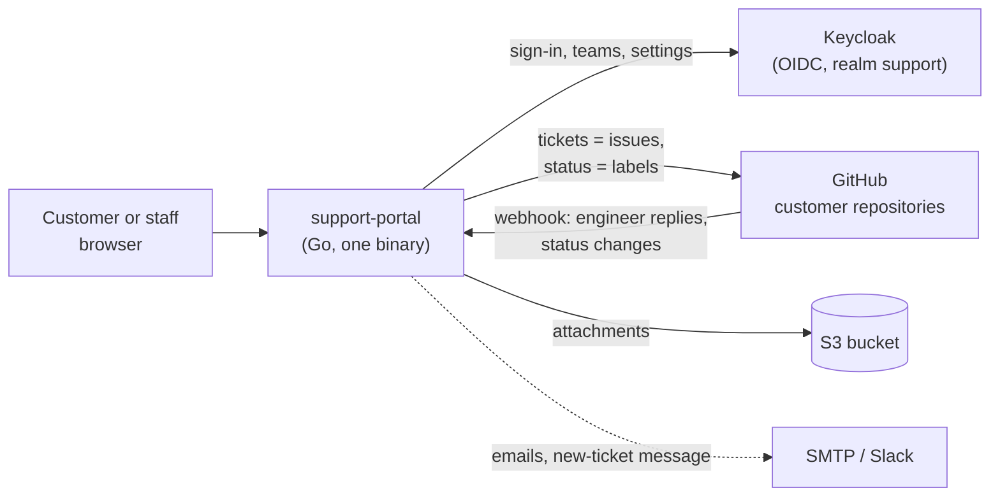

# Giant Swarm Support Portal

A small web portal where Giant Swarm customers raise and follow support tickets. Behind the scenes every ticket is a GitHub issue in the customer's repository, so engineers keep working in GitHub while customers never see it.

## Who it's for

- **Customers who buy Giant Swarm support** but aren't in our GitHub organisation or Slack. Users raise requests, reply and follow the status; customer admins also manage their colleagues.
- **Giant Swarm staff**, who sign in with GitHub and get an internal view across all customers, with reports, a drill-down per customer and onboarding of new customers.

It implements the "Giant Swarm Support Portal" design canvas and the [design brief](docs/design-brief.md).

## How it works



- **Tickets** are GitHub issues labelled `support-portal` in one repository per customer. Status is a label (`support/in-progress`, `support/waiting-for-customer`) or the closed state.
- **People** live in Keycloak: each customer is a group, customer admins have a realm role. Customers sign in with a password or their company's own OIDC provider; Giant Swarm staff sign in with GitHub, and the portal checks their `giantswarm` org membership at every sign-in and every 5 minutes.
- **Attachments** stream to an S3 bucket under the customer's prefix and are served only through the portal.
- **No database of its own.** Everything lives in GitHub, Keycloak and S3.

More in [docs/architecture.md](docs/architecture.md).

## Quick start

Run the portal, Keycloak, S3-compatible storage and a mail catcher on a local [kind](https://kind.sigs.k8s.io/) cluster. You need `kind`, `kubectl`, and Docker or Podman.

```bash
deploy/kind/up.sh
```

Then open `http://portal.localhost:8080` and sign in as one of the demo users (the password is in `deploy/kind/.local/demo-users.env`):

- `anna.berger@nordwerk.example`: customer admin
- `tom.keller@nordwerk.example`: customer user
- `engineer@giantswarm.local`: Giant Swarm staff

Tickets are kept in memory with example data, so no GitHub repository is needed. `deploy/kind/down.sh` deletes the cluster. Run the tests with:

```bash
go test ./...
```

More in [docs/development.md](docs/development.md), including real GitHub issues on kind and staff sign-in with GitHub.

## Further reading

| Topic | Page |
| --- | --- |
| How it works: state, status rules, emails, sign-in, sessions and caches, limits | [docs/architecture.md](docs/architecture.md) |
| Every setting (environment variables), the Keycloak realm, metrics | [docs/configuration.md](docs/configuration.md) |
| Local development on kind, tests, pre-commit | [docs/development.md](docs/development.md) |
| Adding customers (the New customer wizard) | [docs/onboarding-customers.md](docs/onboarding-customers.md) |
| What the GitHub side needs; a sandbox repository | [docs/github-backend.md](docs/github-backend.md) |
| Deploying to the operations cluster (runbook) | [docs/operations-deployment.md](docs/operations-deployment.md) |
| Helm chart values | [helm/support-portal/README.md](helm/support-portal/README.md) |
| Threat model for the Security Team | [docs/threat-model.md](docs/threat-model.md) |
| Code review before go-live | [docs/code-review.md](docs/code-review.md) |
| Design brief | [docs/design-brief.md](docs/design-brief.md) |
| Local kind setup details | [deploy/kind/README.md](deploy/kind/README.md) |

## Security

Report vulnerabilities as described in [SECURITY.md](SECURITY.md). The current threat model and its open findings are in [docs/threat-model.md](docs/threat-model.md).

## License

[Apache 2.0](LICENSE).
